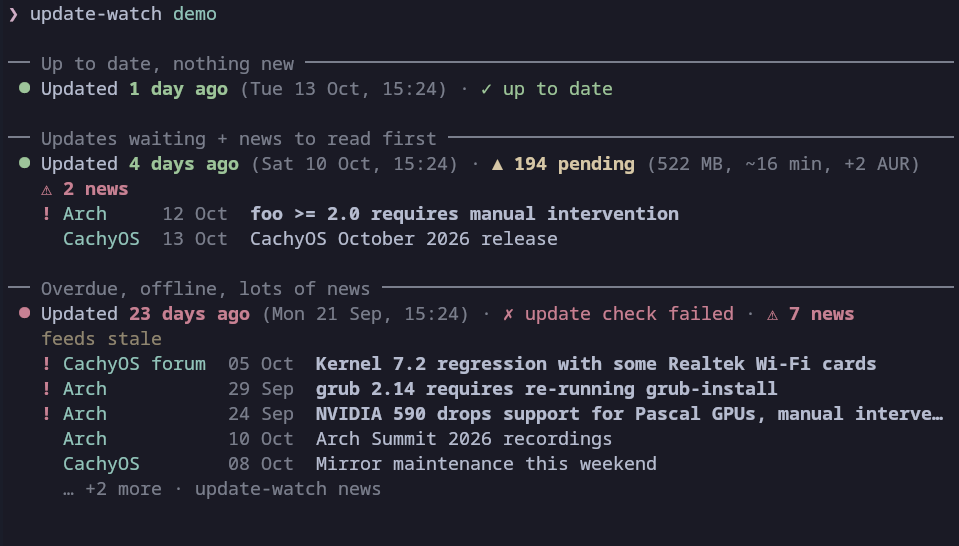
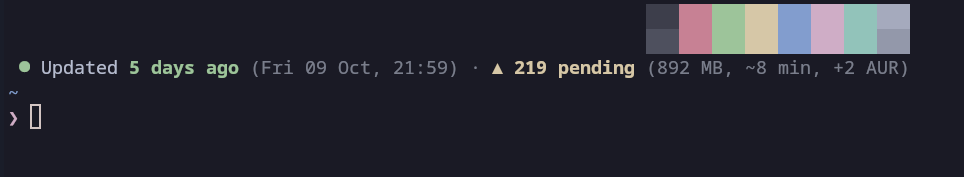

# update-watch



A small, no-root helper that greets every new terminal with:

- **when you last updated** your system, with the date, time and how many days ago
- **what's waiting**: number of updates, download size, change in disk use, and a rough install time learned from your own past upgrades
- **news posted since your last update** from your distro (Arch News, CachyOS, Fedora Common Issues, Ubuntu announcements…), with likely-breaking items flagged in red, so you can read them *before* you update

```
 ● Updated 4 days ago (Fri 09 Oct, 21:59) · ▲ 194 pending (522 MB, ~7 min, +2 AUR) · ⚠ 2 news
   ! Arch     11 Oct  foo >= 2.0 requires manual intervention
     CachyOS  12 Oct  CachyOS October 2026 release
```
---
### **Screenshot:**



If the dot is:

green (&#x1F7E2;) - your last update was under a week ago

yellow (&#x1F7E1;) - under two weeks

red (&#x1F534;) - more than two weeks.

News titles are clickable in kitty, GNOME Terminal, Konsole, WezTerm and most other modern terminals.
Run `update-watch demo` to see every state with made-up data.

Works and intended for **Arch** (Arch, CachyOS, EndeavourOS, Manjaro…), also works on **Debian** (Debian, Ubuntu, Mint, Pop!_OS…) and **Fedora** (Fedora, Nobara, RHEL clones) families, in **bash, zsh and fish**.

It only reads and reports. It **never** installs updates and **never** needs sudo.

## Install

```sh
curl -fsSL https://raw.githubusercontent.com/CrazyCoder009/update-watch/main/get.sh | bash
```

Prefer to look before you run? Do this instead:

```sh
git clone https://github.com/CrazyCoder009/update-watch
cd update-watch
./install.sh
```

The setup wizard detects your distro and shell, lets you pick news feeds (sensible ones are pre-ticked), and asks for your rough download speed. Add `--yes` to accept all defaults without questions.

Requirements: Python 3.8+ (already present on most desktops). On Arch, `fakeroot` might also be needed to check pending updates without root.

## Commands

| command | what it does |
|---|---|
| `update-watch` | print the summary (this is what runs when a terminal opens) |
| `update-watch news` | details: download size, disk change, estimate, and every news item with its link |
| `update-watch demo` | preview the summary with made-up data |
| `update-watch fetch` | refresh news and pending updates now |
| `update-watch setup` | re-run the wizard to change feeds, shells or speed |
| `update-watch doctor` | show the detected distro, config and recent errors |
| `update-watch uninstall` | remove everything (hooks, timer, config, cache) |

## How it works

- **Terminal start is cached and fast (~0.1 s).** The summary only reads local logs and a cache file. A systemd user timer refreshes the cache every 3 hours. Without systemd, a refresh starts in the background when the cache is stale.
- **Last update** comes from the package manager's own records:
  - Arch: `/var/log/pacman.log`, using only `-Syu` runs that actually upgraded something
  - Debian: `/var/log/apt/history.log*`, including unattended-upgrades
  - Fedora: the dnf5/dnf4 history databases, including GNOME Software updates
- **Pending updates and sizes** are checked without root:
  - Arch: a private copy of the sync databases (the same approach as `checkupdates`), plus `paru`/`yay -Qua` for AUR updates
  - Debian: `apt-get -s`, using the package lists that `apt-daily.timer` keeps fresh
  - Fedora: `dnf repoquery --upgrades`, using the metadata that `dnf-makecache.timer` keeps fresh
- **Time estimate** is the median seconds per package from your last ~10 upgrades, multiplied by the number of pending packages. Debian and Fedora also add download size ÷ your speed, because their logs don't include download time. This is a rough guide only.
- **News** comes from RSS/Atom feeds. An item is flagged when its title mentions things like *manual intervention*, *requires*, *boot*, *nvidia*, *regression* or *compromised*. Every Fedora Common Issues post is flagged.

Files: `~/.local/share/update-watch` (code), `~/.local/bin/update-watch`, `~/.config/update-watch/config.json`, `~/.cache/update-watch/`.

## Trying it out / testing

From a clone of the repo, from safest to most real:

```sh
python3 -m unittest -v            # 1. unit tests: sample logs for every distro family, layout at many widths
python3 -m update_watch demo      # 2. see what the summary looks like (made-up data, nothing installed)
tests/try.sh                      # 3. full install into a throwaway HOME, then opens your shell there;
                                  #    type `exit` and it's all deleted. Your real config is never touched.
tests/try.sh zsh                  #    ...same, but in another shell (bash, zsh or fish)
tests/containers.sh               # 4. install + run inside Arch, Debian, Ubuntu and Fedora containers
                                  #    (needs podman or docker; GitHub CI runs this on every push)
./install.sh                      # 5. the real thing; undo with `update-watch uninstall`
```

Config lives in `~/.config/update-watch/config.json`. Set `"hyperlinks": false` there (or `NO_HYPERLINKS=1`) if your terminal shows odd characters around news titles, and use `"max_news"` to change how many news lines are shown.

## Disclaimer (Please read)
I vibe-coded this as I got frustrated updating my system without looking at informant or checking the forums (Which you should do btw, especially rolling release distros) which ended up breaking my system everytime.
Use at your own risk, although I do check the code and don't blindly vibe-code. Life is short and busy especially when you are working in the real world. 
AI Slop is only Slop if you don't have practical use for it. You are welcome to use this however you like as long as it remains free and opensource.


## License

MIT
